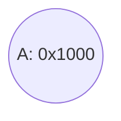
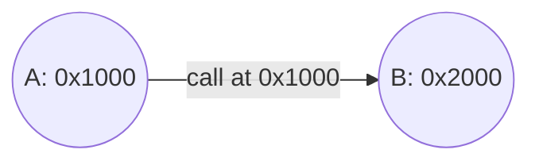
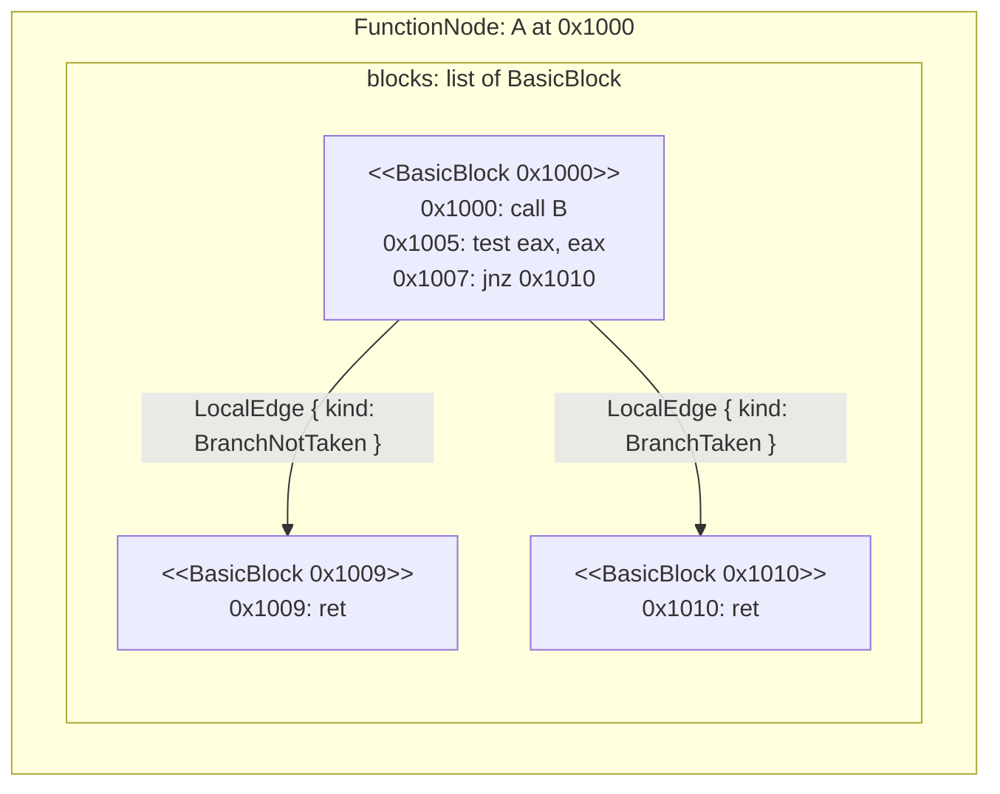
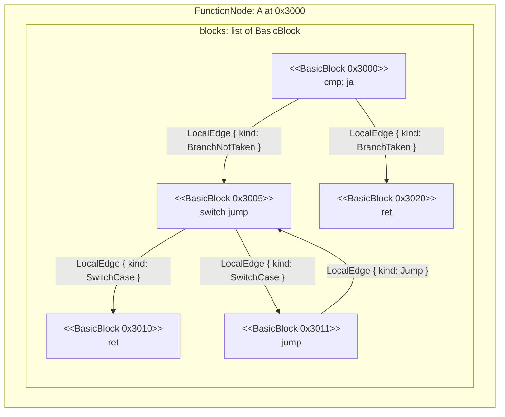
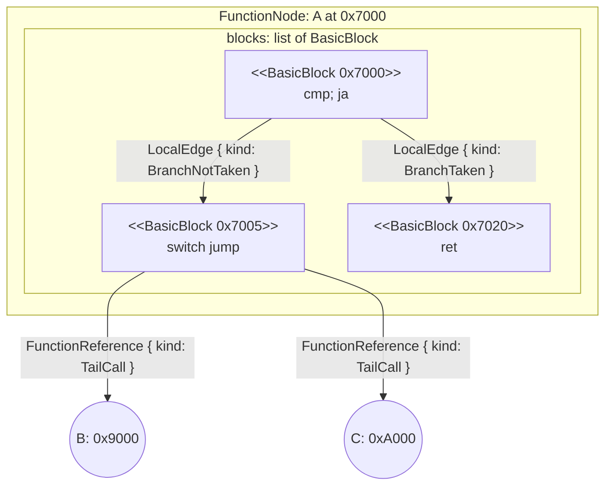
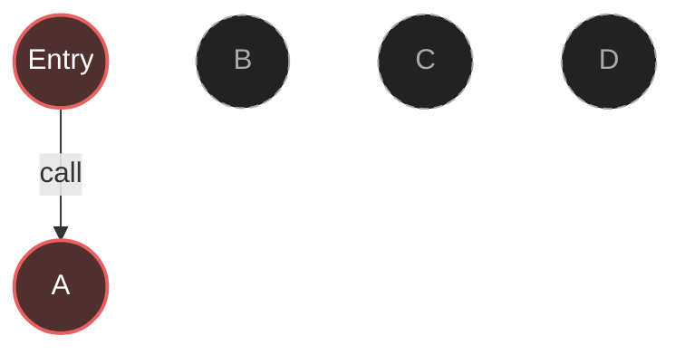
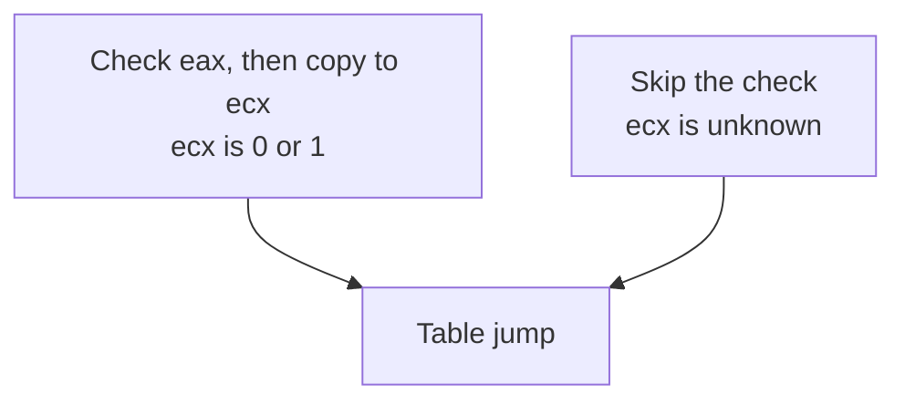
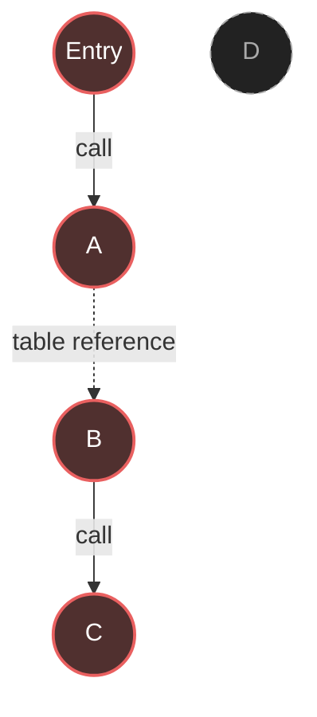
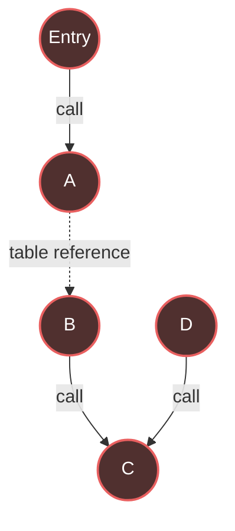
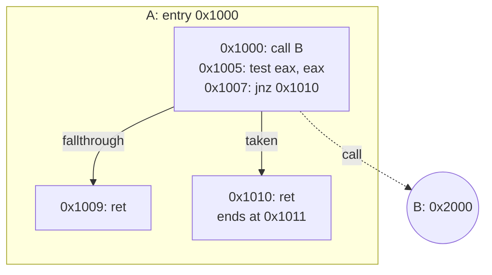

# Function Discovery

!!! warning "Okay Black Hedgehog, you're in the Deep Shit Now"

    This is where the real pain begins. If you got this far, I salute you.

    This is the 'hard' and annoying part of recompilation; and you're about
    to get a walk through the trenches.

    x86 makes this extra fun, believe me 😇

!!! warning "This is an unsolved problem."

    There is no 'perfect solution' to discovering all functions with
    static analysis.

    There are so many ways to call a function:

    - Pass a pointer to function
    - Compute the address dynamically
    - Use a jump table or switch **statement**

    etc.

    Not even 20+ year old $6000 software can do it.
    You've surely seen unmarked code sections in IDA/Ghidra.

    So basically, to say it up front. You're going to have to run the game,
    a lot; 100% it and fix function lengths or missing ones as you go.

    Good news is; there's some debug stuff to help you along.
    e.g. We print missing functions before crashing.

    PS. Remember, time was limited, so this part a bit undercooked ok? thx.

!!! note "Where this happens"

    `Recompiler::analyse` calls `analysis::discover`.

Function discovery uses a `graph` to keep track of discovered functions and
their relationships.
This `graph` is useful later, for both emitting code, and for optimisations.

## How to read the discovery graph

The graph tracks known functions and reachable code inside them.
Watch it grow as we follow A, starting at `0x1000`.

### Function node

A circle marks a known function entry. At first, only A is known:



[DiscoveryGraph] maps entry addresses to [FunctionNode] values. A has
entry `0x1000`.

### Function reference

A calls `0x2000`. The `call` arrow adds B as a separate function.



In A, [FunctionReference] stores `site: 0x1000`, `target: 0x2000`, and
`kind: DirectCall`.
B gets its own [FunctionNode].

If a fallback scan found B first, walking A still notes the call to B.

### Local edges

A function contains **basic blocks**, straight-line runs of instructions.
For example, A calls B, then chooses one of two returns:

```asm
0x1000: call 0x2000
0x1005: test eax, eax
0x1007: jnz 0x1010
0x1009: ret
0x1010: ret
```

The outer box represents A's [FunctionNode].
The inner boxes are its [BasicBlock]s.
Arrows between inner boxes are [LocalEdge]s for the `jnz` paths:

- `taken` reaches `0x1010`
- `not taken` reaches `0x1009`



### Switch cases and loops

A switch table holds code addresses, one per case.

```asm
0x3000: cmp eax, 1
0x3003: ja 0x3020           ; out of range
0x3005: jmp [eax*4+0x4000]  ; dispatch through the table at 0x4000
0x3010: ret                 ; case 0
0x3011: jmp 0x3005          ; case 1: loop to dispatch
0x3020: ret                 ; out-of-range path

0x4000: dd 0x3010           ; table slot 0
0x4004: dd 0x3011           ; table slot 1
```



These are also represented as [LocalEdge]s.

### Switch cases entering other functions

Here, both table slots lead to known function entries outside A:

```asm
0x7000: cmp eax, 1
0x7003: ja 0x7020           ; out of range
0x7005: jmp [eax*4+0x8000]  ; dispatch through the table
0x7020: ret                 ; out-of-range path

0x8000: dd 0x9000           ; case 0: B
0x8004: dd 0xA000           ; case 1: C

0x9000: ret                 ; B
0xA000: ret                 ; C
```



Each case adds a `TailCall` reference from `0x7005` to its target. The guest
jumps to B or C without adding a return address. Generated code may still
call that function and then return.

## Discovery at a glance

!!! info "Where this happens"

    `Recompiler::analyse` calls `analysis::discover` in
    `src/xbox-recomp2/src/recompiler.rs`.

Here's how discovery proceeds:

- **[Walk reachable code]** Start at known functions and follow calls,
  switches, and function pointers until the work queue is empty.
- **[Search for missed code]** Scan sections for switch tables and possible
  function starts that no known path reached.
- **[Walk the new findings]** Repeat the walk, but with newly discovered
  information from brute force search.
    - This gives us more data to refine the function graph.
    - Which helps optimisation down the road, ok?
- **[Size][finalise] functions.**

## Analyse code from known entry points

!!! info "Trace and resolve code reachable from known entry points."

We check:

- Calls/Jumps
- Switch tables
- Function pointers

### 1. Start from known functions

!!! info "First add, all already known functions"

    These typically are:

    - `_xstart` (executable entry point)
    - [functions from config]
    - existing function symbols (import table, etc.)


Red nodes == discovered.  
Black == not discovered.

### 2. Follow direct calls and jumps

!!! info "We walk the code, and follow each direct call and jump"

i.e.

```asm
call 0x13337
jmp  0x42069
```

The target must map to executable code outside configured exclusions.

Here, Entry calls A.



We keep a cache for decoded instructions for performance reasons.

!!! tip "How this happens internally"

    We use a `FunctionWalker` to traverse the reachable code within each function:

    - Direct jumps like `jmp 0x1234`, `call 0x1234` etc. are put in queue.
    - Indirect jumps and switch tables `jmp [reg]` left for later resolution.

### 3. Discover switch tables

!!! warning "Not Implemented Due to Time Constraints"

    Leaving the docs here in unfinished state for reference.

    Might come back here someday. The net effect is, with this you'll be able
    to avoid declaring less missing functions manually.

    You know? Recomp is releasing in 6 weeks as I write this.

    (Was only meant to write this recompiler to optimise final output, aaaaa-
    and here I'm blasting improvements, oof!)

Find the code for each switch case so discovery can follow it.

As you already know, a switch jump instead picks an address from a table:

```text
0x3DDA3E: jmp [eax*4 + 0x3DDA94]
               |        |
           case index   table address
```

Which in C looks like this:

```c
switch (index) {
    case 0:
        /* Code for case 0. */
        break;
    case 1:
        /* Code for case 1. */
        break;
    default:
        /* Code for other values. */
        break;
}
```

In this case, `eax` holds the index, i.e. `0`, `1`. etc:

- `eax = 0`: -> read address at `0x3DDA94`.
- `eax = 1`: -> read address at `0x3DDA98`.

You know the drill, baby.

Internally we treat these jump targets as blocks inside A; see
[Switch cases entering other functions].

!!! question "How to spot a possible switch table"

    We check the decoded instruction:

    - It is a `jmp` that reads a 32-bit target from memory.
    - Scale == 4, i.e. `* 4`
        - We assume the memory is 4 byte aligned for perf.
    - Points to a valid location in the `.xbe`

    Of course, we can't prove it 100%, but you know, good enough.

    This stuff happens inside `Dispatch::recognise` in
    `analysis/reachable/switches/dispatch.rs` btw.

#### Work out which entries belong to the switch

To find the table's size, we look for a bounds check.

For example, `cmp eax, 1; ja default_case` lets only unsigned indexes 0 and 1
reach the table. That gives us two slots.

See [direct index guard] and [byte-index remapping] under the 'brute force'
section.

#### Things to Watch Out For

##### Register remapping

```text
mov ecx, eax
```

##### Branch differences



### 4. Discover function pointers and vtables

#### Callbacks: Passing Function to Address

!!! tip "Sometimes function pointers are pushed as paramter to the caller"

e.g.

```c
int B(void) { return 1; }
int run_callback(int (*callback)(void)) { return callback(); }

int A(void) { return run_callback(B); }
```

Or in ASM:

```asm
; A:
push 0x12000        ; pass function B's address
call run_callback

; Somewhere else...
; run_callback:
mov eax, [esp+4]    ; read callback arg
call eax            ; call B
```

!!! question "How do we detect a possible callback?"

    I use the following checks:

    1. **Address:** (e.g. 0x12000) It must point at an executable segment,
        that's not banned.

    2. **First instruction at the address:** Should be a common function prologue.<br/>
        Functions in x86 often start in a few common ways. Here's the ones we
        check:

        A: Frame pointer setup
        ```asm
        push ebp      ; first instruction: accepted push
        mov ebp, esp
        sub esp, 16   ; reserve 16 bytes for local variables
        ```

        B: [Hot Patch Instructions]
        ```asm
        mov edi, edi  ; dummy mov for hooking
        push ebp
        mov ebp, esp
        ```
        Usually a Windows API thing, but added it anyway; just in case.

        C: Reserve stack space
        ```asm
        sub esp, 16
        ```

    3. **Text filter:** If the first eight bytes are printable ASCII,
       the address is rejected as likely text rather than code.

!!! info "Where this happens"

    This detection is done in `analysis/pointer_tables/immediate.rs` by
    `PointerScan::scan_immediate` and `is_callback`.

#### Indirect Calls (Pointer Arrays)

!!! success "This is implemented."

Basically a switch table, like in [whole-section switch scan].
But, `call` instead of `jmp`.

```asm
call [eax*4+0x30000]      ; eax selects a four-byte slot

; Somewhere in the data section:
0x30000: dd 0x12000       ; function A
0x30004: dd 0x13000       ; function B
0x30008: dd 0x30000       ; function C
```

!!! info "Where this happens"

    Pointer arrays are detected in `analysis/pointer_tables/indirect_calls.rs` by
    `PointerScan::scan_indirect_call`, `call_table_range`, and `PointerScan::scan_table`
    in `analysis/pointer_tables/tables.rs`.

#### Virtual Function Tables (vtables)

C++ supports virtual methods:

```cpp
class Actor {
public:
    virtual void update() {}
};
```

And at runtime, you need to call this 'magic' virtual method:

```cpp
void update_actor(Actor& actor) { actor.update(); } // virtual call
```

The trick to this in common C/C++ compilers is to put a `vtable pointer`,
at offset 0x0 within the struct. i.e. a hidden first struct member.

```asm
mov dword [esi], 0x30000  ; store the vtable pointer at object offset 0
```

In the recompiler, we check stores that follow this pattern; i.e.
- Write to a register at offset 0.
- When stored value points at list of function pointers.

### 5. Finish walking from known entry points

!!! info "As we discover new functions"

    We put them in a queue for a walk.

Basically, we keep popping functions off the queue and walking them until
there's nothing left. Then we search for missed code.

Here, B calls C, so we walk C too.



## Brute-force Search for Missed Code

!!! question "Why brute force?"

    Using the above strategies we can only find 30-50% of functions reliably.

    Unfortunately, there's many ways you can pass a pointer, mutate an address,
    etc. and we can't catch them all.

So; we employ some clever heuristics to try to find more missed code.

### 1. Whole-section switch scan

This scan checks code sections byte by byte, starting at offset 1.

It does not follow instruction boundaries, so an earlier bad decode
cannot hide a possible jump.

Using the [example above]:

```text
0x3DDA3E: jmp [eax*4 + 0x3DDA94]
               |        |
           case index   table address
```

The table must point to somewhere in the .xbe; it can live in a data section.
The scanner accepts scale 4 and ignores any base register.

**Where does the table end?** This is the tricky part. We kind of have to guess
based on the context of the code.

!!! warning "This could still be better."

    This will probably work 'just fine' for most games, but not all.

Use [`[[switch]]` entries](how-it-works.md#switch-tables) to fix missed or
incorrect tables.
Config entries win at the same jump address.

#### Strategy

!!! warning "Multiple passes make switch table discovery more accurate."

    There is a key rule in the strategy here.

    It is ***more dangerous*** if we ***miss*** valid switch table cases, than
    if we pick up invalid cases.

For the sake of correctness, we use the following strategy:

1. Collect as many switch cases as possible first, using the [fallback rules].
    - This is likely to pick up some extra invalid ones past the end of the table.
2. Trim a collected table by recognising bounds checks, like:
    - [direct index guard]
    - [byte-index remapping]

If the bound check cannot be sure about a guard, it leaves the fallback
targets alone.

So step 1 could for instance find `9` targets due to some random data
after the table. But then we could trim because we detect
`cmp ecx, 7; ja default_case` in the assembly.

We only trim when we recognise the pattern and find no known way to skip
its bounds check. See [Known limitation].

#### 1. Fallback

Initial heuristics are as follows:

- Stop at the next table address referenced by a discovered jump.
  For example, `0x2000` to `0x2020` leaves room for eight 4-byte entries.
- Stop at the section's stored or virtual end, or the available `.xbe` bytes.
- Stop if an entry points outside a code section.

No limits otherwise, e.g. on entry count.
But this does mean unrelated data after the table can be picked up as invalid
jumps too.

#### 2. Direct Index Guard

!!! info "Compilers usually compare and branch to the `default` case."

```asm
cmp ecx, 7
ja  default_case          ; unsigned ecx > 7 skips the table
jmp [ecx*4 + targets]     ; slots 0..7: eight addresses
```

Fairly simple, right? Just remember!
Inclusive/exclusive instructions!

e.g.

- `ja` allows the upper bound
- `jae` excludes it.

Good kitty 💜🐱  
Did you know, I love catgirls, nya~

#### 3. Byte-index remapping

!!! tip "Multiple switch cases can map to the same code."

```c
switch (x) {
    case 0:
    case 3:
        do_something();
        break;
    case 1:
    case 2:
        do_something_else();
        break;
}
```

This can look something like this in the assembly.

```asm
cmp eax, 3
ja  default_case          ; only inputs 0..3 reach the byte lookup
movzx ecx, byte [remap + eax]
jmp [ecx*4 + targets]
```

And `remap` is a byte array that maps the cases.

```text
remap: [0, 1, 1, 0]
```

There's 4 states/cases, `0-3` BUT, the table only has 2 slots, for:

- `do_something();` (slot 0, from inputs 0 and 3)
- `do_something_else();` (slot 1, from inputs 1 and 2)

The slot count is `max(remap) + 1` (i.e. 2), since each byte value is a slot
number picked at runtime.

#### Finding the bounds check

!!! info "Start from the table jump"

    We essentially walk backwards from the `jmp` instruction.

The nearby-guard check searches **up to 64 bytes before the table `jmp`**,
staying within the section. Function-wide analysis is not limited to this
window.

***x86 instructions vary in length*** (👈 pain), so we do **not** decode
backwards. Instead, we try each byte as a starting point, from oldest to newest,
and decode **forwards** towards the jump.

For a section starting at `0x1000`, with the table at `0x2000`:

```text
0x1000: 83 F8 07              cmp eax, 7
0x1003: 77 1B                 ja 0x1020  ; default case
0x1005: FF 24 85 00 20 00 00  jmp [eax*4 + 0x2000]
```

Only five bytes precede the jump here.
We try starts `0x1000`, `0x1001`, `0x1002`, `0x1003` and `0x1004`.

Trying `0x1000` gives a valid check: `cmp -> ja` ends exactly where the `jmp`
begins.
We still check the other starts for conflicting matches.

!!! warning "Why do we check other starts?"

    Valid decoding is not a valid bounds check.

    Unfortunately, due to variable-length nature of x86, sometimes decoding
    mid-instruction can still produce a valid decoding.

    e.g. Starting at `0x1001`, inside the `cmp`, also decodes successfully:

    ```text
    0x1001: F8                    clc
    0x1002: 07                    pop es
    0x1003: 77 1B                 ja 0x1020
    0x1005: FF 24 85 00 20 00 00  jmp [eax*4 + 0x2000]
    ```

    This reaches the same `jmp`, but does not check the table index.

The `cmp`, branch and table jump do not have to be next to each other.
Extra instructions are allowed if the bounds check still applies, including
copying the value to another register or using the byte remap above.

!!! note "When in doubt, keep the fallback targets"

    We keep the fallback targets if extra instructions break the bounds check.

    For example, they might replace the index with an unchecked value, or
    change a flag the branch needs before it runs.

#### Important Limitation

!!! info "Sometimes bounds checks can be bypassed."

Best show by example:

```asm
other_code:
    mov ecx, 10
    jmp edx                ; edx points to `dispatch`

checked_code:
    cmp ecx, 7
    ja  default_case
dispatch:
    jmp [ecx*4 + targets]  ; other_code reads slot 10
```

In this case, our heuristics can say this table has `8` slots,
but in reality, `other_code` uses slot 10; which then has to exist.

When this is detected, we don't trim the table based on the first 2 heuristics.
But current code doesn't always detect this; there's unhandled edge cases.

!!! note "I have not observed this in Shadow The Hedgehog (NTSC-U)"

    But it's theoretically possible.

### 2. Code-reference scan

We scan every code section, including code the first walk never reached.
We look for the calls, callbacks, and pointer tables described above.

If some bytes do not decode as an instruction, we skip one byte and keep going.

### 3. Function padding scan

!!! tip "Why align functions?"

    Compilers pad x86 functions to start at multiples of 16 bytes.<br/>
    This can help the CPU fetch instructions efficiently (pipelining).<br/>

    On more modern CPUs, compilers can also use 32-byte alignment,<br/>
    depending on the target CPU and compiler settings.

We check every 16-byte boundary for possible function starts.
Each padding pattern ends with `CC` (`int3`) just before the boundary.

Best to show by example:

**Two padding bytes: `CC CC`**

```asm
0x107E: CC       int3
0x107F: CC       int3
0x1080: 55       push ebp      ; possible function start
```

**Return and padding: `C3 CC`**

```asm
0x107E: C3       ret
0x107F: CC       int3
0x1080: 55       push ebp      ; possible function start
```

**Return with stack adjustment: `C2 xx xx CC`**

```asm
0x107C: C2 08 00    ret 8
0x107F: CC          int3
0x1080: 55          push ebp   ; possible function start
```

The two-byte operand `08 00` adjusts the stack by 8 bytes; it is not padding.

**Direct jump and padding: `E9 xx xx xx xx CC`**

```asm
0x107A: E9 81 00 00 00    jmp 0x1100
0x107F: CC                int3
0x1080: 55                push ebp   ; possible function start
```

The four bytes after `E9` give the jump's relative displacement, not padding.

**Indirect jump and padding: `FF /4 ... CC`**

```asm
0x107D: FF E0    jmp eax
0x107F: CC       int3
0x1080: 55       push ebp      ; possible function start
```

#### Remarks

Near indirect jumps (`FF /4`) must decode and end just before `CC`.<br/>
Far jumps and calls do not qualify. (i.e. this is a tail call check)

An aligned code-section start also qualifies without padding.<br/>
i.e. If we have an instruction at a multiple of 16, and it looks like
a function prologue, e.g. `push ebp`, we add that too.

!!! note "Skip code already found"

    The padding scan skips:

    - Known function entries, even with no decoded body.
    - Bytes covered by decoded instructions.
    - Configured [`fixes.functions`](how-it-works.md#1-load-the-config) ranges:
      `[start, start + size)`, excluding the end.

!!! note "On other compilers."

    Some compilers use `0x90` (nop) instead of `0xCC` (int3) for padding;
    particularly those in the GNU family.

### 4. Tail-jump scan

!!! tip "A **tail call** avoids returning to a function that has nothing left to do."

For example, A just returns B's result:

```c
int A(int x) {
    return B(x);
}
```

Normally, B returns to A, then A returns to its caller.<br/>

However, if the calling convention and stack layout allow it,
the compiler can use a jump instead:

```asm
; A has prepared B's arguments stack.
jmp B   ; B returns directly to A's caller
```

In which case, B will return to whoever called A, as the return address is
on the stack.

!!! note "This is a trivialised example"

    In practice, an example this easy would just be inlined by the compiler.<br/>
    A realistic one would be a shared common helper called at end of several
    functions.

#### How do we find them?

!!! info "We decode each code section once, from start to end."

    If decoding fails, skip one byte and retry.

Reads respect section/file bounds and banned or invalid ranges.
An unknown target qualifies when:

- The instruction is a direct, (near) `jmp`.
- The target is readable code, not an import.
- Its first instruction decodes, is supported, and is not `int3`.
- No return-like bytes (`C3` or `C2 xx 00`) start in the four bytes after the jump.
- The section has a known function start at or before the jump.
- The target is before the nearest such start or at/after the next known start.

!!! note "This is a pure guess"

    These checks suggest a separate function; but are not 100%.

## Walk the new findings

After the scans find D, walk **all known functions** again, not just D. New
switch tables can reveal missed blocks in A, B, or C.



Repeat until the queue is empty.

## Determine function sizes

!!! info "We calculate function sizes from the discovery graph."

We go through the graph one function at a time. Each [FunctionNode] holds the
instructions we reached. We find the instruction at the highest address and
use its end to calculate the size.

Here's a graph of function A:



In A, that's the `ret` at `0x1010`, ending at `0x1011`.<br/>
Subtract A's entry, `0x1000`, to get **17 bytes**.

B stays separate.

## Finalise the function list

!!! info "We apply manual sizes, sort functions, and keep their references."

    The references stay available for later analysis.

### Apply manual sizes

For functions in `fixes.functions`, we generate code across the range you
specified in the config.

A jump to the range's start calls the function. Jumps further into the range
use local labels.

If another function starts inside the range, we generate it separately when
we find it through:

- the executable entry point or an existing function symbol;
- a direct call, resolved indirect call, tail call, or function-pointer
  reference;
- its own `fixes.functions` entry.

The configured function keeps its size. We drop starts inside its range that
were found only by fallback scans.

### Sort and name

We sort functions by start address and register a `sub_<base>` symbol with
each function's size.

### Keep references

!!! info "We keep the references found during discovery."

    These help us optimise functions and update their callers when changing
    the ABI.<br/>(how arguments and results are passed).

#### Access the results

- `Recompiler::function_graph()`: known references to and from each function.
- `function_body(address)`: instructions chosen for generation. Configured
  functions use their explicit ranges.
- `unresolved_sites(address)`: indirect transfers inside the function with
  incomplete target sets.

## Limitations and notes

### Runtime checks

Diagnostics report overlapping decodes and unreadable paths.<br/>
Generated code aborts at runtime for:

- a missing selected instruction at the entry;
- invalid selected bytes;
- block ends lacking a supported transfer or continuation.

Where helpful, we print errors in debug mode.

### Manual fixes

Use a disassembler or runtime reports to find the needed fixes:

- **Missing function or wrong size:** supply its guest address and size in bytes
  through [`fixes.functions`](how-it-works.md#1-load-the-config).
- **Missing switch cases:** supply their targets with a
  [`[[switch]]` entry](how-it-works.md#switch-tables) so discovery can size them.

[fallback rules]: #1-fallback
[direct index guard]: #2-direct-index-guard
[byte-index remapping]: #3-byte-index-remapping
[Known limitation]: #important-limitation
[`fixes.functions`]: how-it-works.md#1-load-the-config
[direct-index]: #2-direct-index-guard
[byte-remap]: #3-byte-index-remapping
[whole-section switch scan]: #1-whole-section-switch-scan
[tail-jump scan]: #4-tail-jump-scan
[Walk reachable code]: #analyse-code-from-known-entry-points
[Search for missed code]: #brute-force-search-for-missed-code
[Walk the new findings]: #walk-the-new-findings
[Size]: #determine-function-sizes
[finalise]: #finalise-the-function-list
[configured functions]: how-it-works.md#1-load-the-config
[DiscoveryGraph]: https://github.com/Sewer56/XboxRecomp2/blob/20dd955d44a00e6ff78d1f39e5f0e2e07b78b306/src/xbox-recomp2/src/analysis/graph/mod.rs
[FunctionNode]: https://github.com/Sewer56/XboxRecomp2/blob/20dd955d44a00e6ff78d1f39e5f0e2e07b78b306/src/xbox-recomp2/src/analysis/graph/function_node.rs
[BasicBlock]: https://github.com/Sewer56/XboxRecomp2/blob/20dd955d44a00e6ff78d1f39e5f0e2e07b78b306/src/xbox-recomp2/src/analysis/graph/basic_block.rs
[LocalEdge]: https://github.com/Sewer56/XboxRecomp2/blob/20dd955d44a00e6ff78d1f39e5f0e2e07b78b306/src/xbox-recomp2/src/analysis/graph/basic_block.rs
[FunctionReference]: https://github.com/Sewer56/XboxRecomp2/blob/20dd955d44a00e6ff78d1f39e5f0e2e07b78b306/src/xbox-recomp2/src/analysis/graph/function_reference.rs
[UnresolvedTransfer]: https://github.com/Sewer56/XboxRecomp2/blob/20dd955d44a00e6ff78d1f39e5f0e2e07b78b306/src/xbox-recomp2/src/analysis/graph/function_reference.rs
[Switch cases entering other functions]: #switch-cases-entering-other-functions
[Hot Patch Instructions]: https://devblogs.microsoft.com/oldnewthing/20110921-00/?p=9583/
