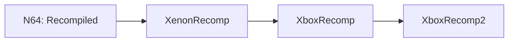
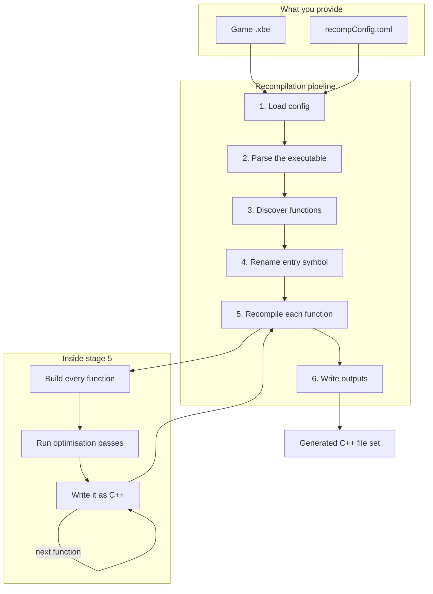

# How It Works

!!! note "This repo is only the code generator"

    XboxRecomp2 translates the game code to C++ and nothing else.<br/>
    No runtime, loader, or graphics. Refer to original [XboxRecomp] for that.

    The generated code links into a host project such as ShadowRecomp.

XboxRecomp2 recompiles original Xbox x86 machine code into C++ source.
Point it at a config for a game's `.xbe` and it emits a C++ file set you
compile for your host.

Generated files are `.cpp` and `.h` units compiled as C++.
Style is C-like, plain functions, no classes.

## Where It Comes From

The approach descends from [N64: Recompiled] through the Xbox 360
scene:



- **[N64: Recompiled]**: the origin of the static-recompilation
  approach. [XenonRecomp] names it as direct inspiration.
- **[XboxRecomp]**: Sora's original-Xbox x86-to-C++ recompiler, a
  fork of XenonRecomp. It's a raw 1:1 instruction translator.
- **XboxRecomp2**: this repo.

## What You Need First

Checklist of what to extract or prepare before a run:

1. **Game `.xbe`.** The original Xbox executable.

Have an XISO? Unpack it first with [extract-xiso].

### What you May Need down the Road

!!! info "Sometimes automated analysis may miss things"

- **Functions:** Missing functions can be added to `fixes.functions` in
  `recompConfig.toml`.
- **Switch tables:** Missing jump tables can be added with `[[switch]]` entries.

Missing items can be derived in 2 ways:

- Disassembler like Ghidra/IDA.
- Running game and collecting the missing-function reports it produces.

And don't forget:

- **Patches and hooks**: You may need a little patch or two to the game code;
   in addition to a runtime.

## The Pipeline



## Step by Step

!!! note "Where this happens"

    Start with `xbox_recomp2_xbox::run` (`src/xbox-recomp2-xbox/src/lib.rs`).

    That's the Xbox entry point. It calls the format-neutral `run_with`
    (`src/xbox-recomp2/src/lib.rs`), which drives the `Recompiler` steps
    (`src/xbox-recomp2/src/recompiler.rs`), with Xbox defaults pre-initialised.

    You can follow along from there.

| Call                              | Steps |
| --------------------------------- | ----- |
| `Recompiler::load_input`          | 1-2   |
| `Recompiler::analyse`             | 3     |
| `Recompiler::rename_entry_symbol` | 4     |
| `Recompiler::recompile`           | 5-6   |

### 1. Load the config

!!! note "Where this happens"

    `Recompiler::load_input` parses `recompConfig.toml` and reads the XBE
    named by `main.file_path`.

Example based on [ShadowRecomp]'s [recompConfig.toml]:

```toml
[main]
file_path = "game.bin"          # the input binary, relative to this file
out_directory_path = "out/"     # generated files land here
debug = false                   # runtime diagnostics, enable till game stable.
                                # then disable for perf.

# Safe optimisations that improve performance without changing behaviour.
[optimizations]
enable = true                    # master toggle
eliminate_return_slot = true     # don't put return addresses on the stack where possible
eliminate_stack_args = true      # optimise away push+pop across function calls
trust_callee_returns = false     # trust `ret N` to fix up the stack on function exit
optimize_x87 = true              # speed up x87 code
optimize_mmx = true              # keep MMX registers in a local array
eliminate_dead_x87_status = true # skip x87 C0-C3 writes nothing reads
eliminate_dead_flags = true      # compute only flags later instructions read
fuse_compare_branch = true       # turn cmp + jump into a plain `if (a < b)`
find_ebp_frames = true           # let nonvolatile_stack cover [ebp+N] where safe
idiv32_after_cdq = true          # 32-bit divide for `idiv` after `cdq`
find_string_direction = true     # skip the direction flag check in `rep movs` and co.

# Hacks that sacrifice accuracy for speed. Usually safe.
# But test your recomp without, before testing with.
[speed_hacks]
enable = true # master toggle

# 64-bit instead of 80-bit x87 trig and 2^x.
# Side effect: Results can differ in the last few bits (tiny accuracy difference).
fast_trig = true

# Don't track x87 overflow, divide-by-zero and precision-loss flags.
# Side effect: None except for special functions. Games almost never read these.
fast_x87_status = true

# Don't check for x87 stack overflow and underflow.
# Side effect: Only buggy compiler output over- or underflows the stack, it'll go unnoticed.
fast_x87_stack = true

# Treat `ffree st(n-1)` down to `ffree st0`, back to back, as pops.
# Side effect: The x87 `top` field differs from real hw.
#              Only code reading the raw status word or saved FPU state would notice.
#              So basically no code in practical cases.
fast_x87_ffree = true

# FSCALE uses a 64-bit path instead of 80-bit.
# Side effect: Huge scales (beyond 2^±1022) give wrong results.
fast_fscale = true

# Don't track SSE exception flags.
# Side effect: None except for special functions. Games almost never read these.
fast_sse_status = true

# Let the compiler keep stack values in registers.
# Side effect: Unsafe if another thread could read your thread's stack.
#              But this has practically 0% chance of happening.
nonvolatile_stack = true

# Let the compiler merge or drop (packed) SSE loads and stores.
# Side effect: Loads whose result is never used are skipped.
#              So like CMOV, a guest crash is avoided when it should happen.
plain_sse_memory = true

# Let the compiler merge/drop guest loads and stores outside the stack.
# Side effect: Unsafe if a host thread writes memory that the guest code
#              reads without/lock or wait loop. (Concurrency)
nonvolatile_memory = true

# CMOV only reads memory when it actually moves.
# Side effect: Invalid addresses are skipped.
#              Stops game from crashing where real HW might have crashed.
lazy_cmov_load = true

# Use native word size for guest addresses.
# e.g. in `[esi+0x10]` treat 'esi' as `64-bit` on 64-bit systems.
# Side effect: Usually safe to use, just beware this will break 32-bit wraps.
#              (e.g. `[eax-4]` with `eax = 0`) would underflow and produce wrong result.
#              Xbox compiler would never emit this though.
#
#              (On Xbox, that's kernel space, you can't read it!)
#
# Edge case:
#              In SUPER RARE cases we can have something like `[eax+0x462E08]`.
#              Where eax is NEGATIVE. That's bad, and is an overflow.
#              We therefore limit offsets to 0x10000 (Xbox base address - chosen arbitrarily).
native_sized_addresses = true

# Run `rep movs` and `rep stos` as memmove and memset.
# Needs native_sized_addresses.
# Side effect: Other threads may see the copied bytes in any order.
#              Real x86 allows this too, so games shouldn't rely on it.
rep_memmove_memset = true

# Assume calls never pass results in eflags.
# Side effect: Breaks hand-written asm that does this. (Compilers never do this.)
#              Only affects calls we can't trace, e.g. indirect calls/callbacks etc.
#              Other calls we do trace correctly.
clobber_eflags_for_unknown_code = true

# Keep the stack slots of leaf functions (no calls) in C++ locals.
# Side effect: Stack memory below ESP differs from real hw after a return.
#              Shouldn't affect real game code (in any context).
#              Only dirty hacks, maybe debuggers. So nothing on Xbox.
stack_slots_in_locals = true

# Extra hints for the optimisation passes.
# Danger: Only add if you know what you're doing. (can read ASM)
#
# - Missing hints only cost speed
# - Wrong hints break the game.
[optimization_hints]

# Info about x87 stack upon entering a function.
#
# Almost all x87 code on OG Xbox enters functions with empty x87 stack,
# as MSVC passes parameters either via stack (usual), or registers.
#
# But in very rare cases, parameters are passed via the x87 stack; such as
# in CRT code.
#
# Sometimes in this code, we can't analyse it fully due to instructions
# we forbid in analysis like FFREE/FXRSTOR; or other limitations.
#
# This allows you to set overrides.
x87_stack_effects = [
  {
    address = 0x37DF64, # _CIpow
    stack_at_entry = 2, # items on the x87 stack at function entry (its parameters)
    stack_at_exit = 1,  # items on the x87 stack at function exit (0, or 1 for a float result)
  },
]

[fixes]
functions = [                   # add any missed functions here
  { address = 0x1000, size = 0x50 },
  { address = 0x2000, size = 0x671 },
]

invalid_instructions = [        # instruction bytes to treat as data
  { data = 0x11223344, size = 4 },
]

banned_addresses = [            # address ranges never recompiled
  { start = 0x3000, end = 0x3100 },
]

[[switch]]                      # a jump table the executable scan missed
register = "edx"
base = 0x1234
labels = [0x100, 0x200, 0x300]  # jump target per case index

[[midasm_hook]]                 # call C++ at a guest address
name = "OnLoad"
address = 0x8000
return = true                   # return from the recompiled function
```

The `[optimizations]` and `[speed_hacks]` switches are explained in
[Optimizations].

Stubbed: the real file lists hundreds of functions and hooks.

!!! note "Every address listed is a guest virtual address"

    This is the address you usually see in IDA/Ghidra/Memory Editor.

    It's where the code resides in RAM, not in the RAW `.xbe` file.

    Relevant to:  

    - `functions`
    - `banned_addresses`
    - `invalid_instructions`
    - `function_hooks`
    - `x87_stack_effects`
    - `midasm_hook`
    - `switch` etc.

    In case of Shadow the Edgehog, the game code (`.text`) begins at
    `0x11000` in RAM, but `0x1000` in the `.xbe` file.

#### Whole-function replacements

!!! danger "Some optimisations may interfere with function overrides"

If you replace a guest function with `X86_OVERRIDE_FUNC` in your host project,
list its address here, then regenerate:

```toml
[fixes]
function_hooks = [0x2B35F0]
```

For reference, a replacement looks like this:

```cpp
X86_FUNC_IMPL(__imp__sub_2B35F0);  // the original, still available
X86_OVERRIDE_FUNC(sub_2B35F0)      // your replacement
{
    // your code
    __imp__sub_2B35F0(ctx, base);  // call the original, if you need it
}
```

Some optimisations out there change the calling convention of the function.
(i.e. How a function receives its arguments, etc.)

Forgetting to list this can therefore be quite dangerous.

#### Midasm Hooks

!!! info "`[[midasm_hook]]` entries call your C++ at a guest address"

```toml
[[midasm_hook]]                            # call C++ with the guest context
name = "SelectModeUnlockCheckBypassMidAsmHook"
address = 0x29A460

[[midasm_hook]]                            # branch on the hook's result
name = "EasierUnlockLastStoryMidAsmHook"
address = 0x23D64A
jump_address_on_true = 0x23D64F
```

The host project defines the C++ side. Both examples come from
ShadowRecomp, in entry order:

```cpp
void SelectModeUnlockCheckBypassMidAsmHook(X86Context& __restrict ctx, uint8_t* base)
{
    if (Config::AllStagesUnlocked)
    {
        ctx.eax.u32 = 1;
    }
}

bool EasierUnlockLastStoryMidAsmHook(X86Context& __restrict ctx, uint8_t* base)
{
    if (Config::EasyLastStoryUnlock)
    {
        if (ctx.edi.u32 >= 5)
        {
            return true;
        }
    }

    return false;
}
```

`[[midasm_hook]]` keys:

| Key                                 | Effect                                        |
| ----------------------------------- | --------------------------------------------- |
| `address`                           | Guest virtual address to hook                 |
| `name`                              | C++ hook function name                        |
| `jump_address`                      | Always jump here after the hook               |
| `jump_address_on_true`              | Jump here when the hook returns true          |
| `jump_address_on_false`             | Jump here when the hook returns false         |
| `return_on_true`, `return_on_false` | Return from the guest function on that result |
| `return`                            | Return from the guest function                |

#### Switch Tables

A jump table stores the addresses of switch cases. For example, from
Shadow's `default.xbe`:

1. **The game picks a case using `eax`:**

    ```asm
    mov eax, [esp+0x14]      ; case index
    cmp eax, 3
    ja 0x3DDA85              ; out of range: game's default path
    jmp [eax*4+0x3DDA94]     ; at 0x3DDA3E: read a target and jump
    ```

2. **The table holds four 4-byte addresses:**

    ```text
    Table slot   Target      Case
    0x3DDA94     0x3DDA45    0
    0x3DDA98     0x3DDA58    1
    0x3DDA9C     0x3DDA6B    2  <-- eax = 2 picks this target
    0x3DDAA0     0x3DDA7E    3
    ```

    `eax = 2` → read at `0x3DDA94 + 2*4` → jump to `0x3DDA6B`.

3. **XboxRecomp2 replaces the `jmp` with a C++ switch:**

    ```cpp
    switch (ctx.eax.u32) {
    case 0: goto loc_3DDA45;
    case 1: goto loc_3DDA58;
    case 2: goto loc_3DDA6B;
    case 3: goto loc_3DDA7E;
    default:
        fprintf(stderr, "Unhandled switch index at 0x3DDA3E: %u (4 entries); check [[switch]] configuration.\n",
                static_cast<unsigned>(ctx.eax.u32));
        fflush(stderr);
        std::abort();
    }
    ```

    The earlier `ja` handles the game's default path. If an index has no
    generated case, the C++ switch prints the dispatch address, index and
    entry count to stderr, then aborts, including in release builds.
    Check the table's `[[switch]]` configuration if this happens.

Cases inside the function use `goto`. A case targeting another known function
calls it, then returns.

XboxRecomp2 [looks for these tables automatically]. To add a missed table
or replace one at the same jump address:

```toml
[[switch]]
register = "eax"    # case index
base = 0x3DDA3E     # the jmp, NOT the table
# Targets in case order:
labels = [0x3DDA45, 0x3DDA58, 0x3DDA6B, 0x3DDA7E]
```

### 2. Parse the executable

!!! note "Where this happens"

    See `parse_executable` called via `Recompiler::load_input`.

Here we need to find all the code in the original binary.
To achieve this, we need a few things.

- **Image base address**: where the `.xbe` lands in virtual memory (RAM).
  Needed to resolve baked-in pointers/vtables etc.
    - 32-bit Windows EXE typically use `0x400000` (when ASLR off).
    - Xbox games typically use `0x10000`.
- **Entry point**: where execution starts, stored XOR-scrambled.
- **Section map**: the named sections;
    - `.text` for code and
    - `.rdata` for read only data
    - `.data` for writable data
    - etc.
- **Import Table ([Kernel thunks])**: calls to kernel functions.
    - Similar to Windows EXE's import tables.
- **D3D8 build version** (from the library versions block).
    - Not an Xbox dev myself, but apparently the render-state
      layout differs between D3D8 builds. So we kinda need this.

Parsing goes through the `xbox-recomp2-xbox` crate.

!!! warning "A section's virtual size can exceed the bytes stored in the `.xbe`."

    For example a section at `0x1000` can have:

    - Stored size of `0x20`
    - Virtual size of `0x100`

    When this is loaded into memory, the remainder of the size not backed by
    stored bytes is zero-filled.

    We must be careful during generation to account for this.

#### Import Table (Kernel Thunks)

!!! info "Surprisingly, the kernel isn't statically linked on Xbox."

    I'd expect it for this console era, but not here. hmm...

Calling works roughly like this (Shadow the Hedgehog - NTSC-U):

1. `.text` jumps through a slot:

    ```asm
    0x002AC43E:  FF 15 E4 9A 42 00   ; call dword ptr [0x00429AE4]
    ```

    An indirect call: we jump to whatever's at `0x00429AE4`.

2. The slot, in `.rdata`, holds an 'ordinal' (index), not an address:

    ```asm
    0x00429AE4:  0x80000115   ; flag bits + ordinal 0x115
    ```

3. The ordinal names the function: `0x115` is `RtlEnterCriticalSection`.
   <br/><br/>On a real Xbox, the ***xbe loader patches the slot in memory***
   before the game runs:

    ```asm
    0x00429AE4:  0x80017BD0   ; address was modified
    ```

    So by the time the game gets there, it points to a real function.

On the Xbox, these ordinals are hard-wired, so we know them ahead of time.  
We can just write the indirect call with a direct one.

!!! note "This is basically a slightly simpler version of what Windows does."

    Here we have one built-in table. Windows has a table per-DLL.

    The thunk data in `.rdata` can be thought of as equivalent of the IAT
    (Import Address Table) of 'ntdll' in Windows.

!!! info "Where we store this table"

    See `src/xbox-recomp2-xbox/src/xbe/kernel/exports.rs`.

### 3. Discover functions

!!! warning "The hard part."

- We start at all known entry points.
- Then follow calls, switches, function pointers. 
- A bit of brute forcing.

And then we're good.  
See [Function Discovery] for more details.

### 4. Rename the entry symbol

!!! note "Where this happens"

    `Recompiler::rename_entry_symbol` (`recompiler.rs`) renames the entry
    point symbol to `_xstart`, the emitted contract's entry symbol name.

### 5. Recompile each function

!!! note "Where this happens"

    We now build these analysed functions with `build_function`, run the
    optimisation passes (`codegen/optimizations/`), then write each one with
    `write_function` (`codegen/function/mod.rs`).

    (Called from `Recompiler::recompile`)

In the most short way possible to explain; each guest function becomes one
C++ function:

- Every instruction becomes 1 or more lines of C++.
- Original instruction for reference is kept as comment above.
- Branches (`jmp`) inside the function become `goto`s.
- Calls `call` to other functions become C++ calls.
- Guest registers live in `ctx` (`X86Context`).
- Guest memory starts at `base`.

See [Recompiling Functions] for the step by step.

### 6. Write the outputs

!!! note "Where this happens"

    `OutputWriter` (`output/disk.rs`) writes the file set that
    `Recompiler::recompile` filled into `out_directory_path`.

It splits units every 256 functions and prints progress every 600
functions.

| File                   | Contents                              |
| ---------------------- | ------------------------------------- |
| `x86_config.h`         | Generated config header               |
| `x86_context.h`        | The run's context header              |
| `x86_recomp_shared.h`  | Declarations shared by all units      |
| `x86_func_mapping.cpp` | Guest address to C++ function mapping |
| `x86_recomp.N.cpp`     | Recompiled functions, 256 per unit    |

## Running It

From the repo root:

```bash
cargo build -p xbox-recomp2-cli            # build the xboxrecomp2 binary
cargo install --path src/cli               # or install into ~/.cargo/bin

xboxrecomp2 recompConfig.toml              # full run from a config
xboxrecomp2 game.xbe                       # same run, derived minimal config
```

Input can either be config file or a binary:

- an XBE executable (by its `XBEH` magic) generates a minimal config
  and outputs to `out/` beside the `.xbe`
- anything else parses as a config TOML

### Compiler flags

!!! tip "With Clang, raise its analysis limits for the generated code"

I'll let the note I left in `ShadowRecomp` do the talking:

```text
# Note(sewer): Recompiled functions are huge.
# 
# Especially since we have to emulate, a lot of things like eflags, stacks, etc.
# every original instruction is bloated a fair bit.
# 
# This sometimes makes Clang's (LLVM's) default analysis limits give up on
# functions a little too soon.
if (CMAKE_CXX_COMPILER_ID STREQUAL "Clang")
    set(SHADOW_RECOMP_LLVM_LIMITS
        -dse-memoryssa-scanlimit=100000
        -dse-memoryssa-walklimit=100000
        -dse-memoryssa-path-check-limit=100000
        -dse-memoryssa-defs-per-block-limit=100000
        -dse-memoryssa-otherbb-cost=1
        -memssa-check-limit=100000
        -memdep-block-number-limit=100000
        -memdep-block-scan-limit=100000
        -gvn-max-num-insns=100000
        -gvn-max-num-deps=100000
        -gvn-max-block-speculations=100000
        -available-load-scan-limit=100000
    )
    foreach(limit IN LISTS SHADOW_RECOMP_LLVM_LIMITS)
        # clang and clang-cl both accept `-mllvm`.
        add_compile_options("SHELL:-mllvm ${limit}")
    endforeach()
endif()
```

There's a fair few functions where Clang gives up prematurely if limits are 
not raised.

While some of my optimisations manage to avoid such cases (by simply emitting
less code and abusing templates with `constexpr`); there's still a few cases
where we don't, or simply *can't* reduce enough.

!!! tip "Turn off `-fzero-call-used-regs` if your toolchain turns it on"

Some toolchains, like Nix's clang wrapper, enable it by default.
It clears every register a function used before each return:

```asm
pop    rbp
xor    eax, eax     ; <- added before every return
xor    ecx, ecx
xor    edi, edi
xor    esi, esi
ret
```

That's ~1.8% of the code in Shadow (at time of measure).

```cmake
include(CheckCXXCompilerFlag)
check_cxx_compiler_flag(-fzero-call-used-regs=skip SHADOW_RECOMP_HAS_ZERO_CALL_USED_REGS)
if (SHADOW_RECOMP_HAS_ZERO_CALL_USED_REGS)
    add_compile_options($<$<COMPILE_LANGUAGE:C,CXX>:-fzero-call-used-regs=skip>)
endif()
```

With Nix, also add `"zerocallusedregs"` to `hardeningDisable` in your flake.

[N64: Recompiled]: https://github.com/N64Recomp/N64Recomp
[Unleashed Recompiled]: https://github.com/hedge-dev/UnleashedRecomp
[XenonRecomp]: https://github.com/hedge-dev/XenonRecomp
[XboxRecomp]: https://github.com/FoxWorkshop/XboxRecomp#instructions
[ShadowRecomp]: https://github.com/FoxWorkshop/ShadowRecomp
[extract-xiso]: https://github.com/xboxdev/extract-xiso
[why]: index.md#why-i-wrote-it
[recompConfig.toml]: https://github.com/FoxWorkshop/ShadowRecomp/blob/e33a252c80b11c9a68dd48a796f8d21d3e0230b1/ShadowRecompLib/config/recompConfig.toml#L4
[Kernel thunks]: #import-table-kernel-thunks
[looks for these tables automatically]: function-discovery.md#3-discover-switch-tables
[Function Discovery]: function-discovery.md
[Recompiling Functions]: recompiling-functions.md
[Optimizations]: optimizations/index.md
