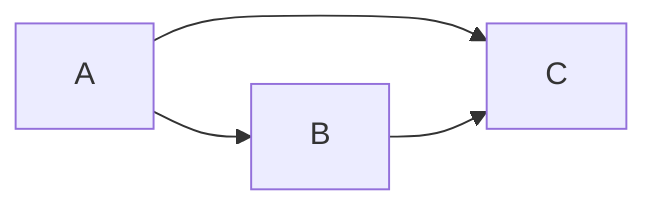

# Function Stacks

!!! tip "Works out what each call does to ESP and EBP."

    So [Stack Tracking] can step over a `call` instead of giving up.

!!! note "Where this happens"

    Under `codegen/optimizations/helpers/function_stacks/`:

    - `FunctionStacks::build` in `mod.rs` runs the steps below.
    - `callees_first` in `call_graph.rs` picks the order (step 1).
    - `FunctionStacks::entry_for` in `mod.rs` handles one function (steps 2 and 3).
    - `effects/walked.rs` and `effects/trusted.rs` work out what a call does (step 3).

## Why we need it

[Stack Tracking] follows ESP through a function.<br/>
When it reaches a `call`, it needs to know where ESP ends up afterwards.

!!! info "This can be a bit tricky"

In x86, parameters are generally passed on the stack. (boo! slow!)
(8 registers :/)

And with that; there's 2 common ways to clean up these stack parameters
after calling a function.

**Caller cleans up:**

The caller resets the stack after the call.

```asm
B:
    ; ...
    ret             ; pops only the return address

caller:
    push 1          ; ESP: -4
    call B          ; ESP: -4, the argument is still there
    add  esp, 4     ; ESP: 0
```

Most commonly `cdecl` (look it up).

**Callee cleans up:**

The called function resets it with `ret N`.

```asm
B:
    ; ...
    ret 4           ; pops the return address and the argument

caller:
    push 1          ; ESP: -4
    call B          ; ESP: 0
```

Most commonly `stdcall` (look it up).

The second case is the important one.

See; in the case of B, we need to know that the `push 1` is undone
by the function called.

Historically, Microsoft APIs use `stdcall` (the latter); while most compiled
code uses `cdecl`. This basically guarantees you'll see both inside the same
Xbox binary.

!!! question "Why is this important?"

    Some perf optimisations require us to know where the stack is at all points.

    For example:  

    - Rewriting stack spills as variables.
    - Eliminating return address slot.
    - Eliminating stack arguments.
    - Shifting all stack accesses.
  
    etc.

## What we store

For each function, we keep an entry like this:

```rust
// Simplified from `function_stacks/mod.rs` and `function_stack.rs`.
struct Entry {
    /// ESP and EBP at each instruction inside the function.
    /// `None` if we only trust its `ret N`.
    stack: Option<FunctionStack>,

    /// ESP and EBP after a call to the function returns.
    effect: CallEffect,
}

struct CallEffect {
    /// Bytes its `ret` pops, including the return address, if there is one.
    /// `ret 0` -> 4, `ret 4` -> 8.
    popped: u32,

    /// Whether EBP is the same after the call.
    /// If not, EBP is unknown after the call.
    keeps_ebp: bool,
}
```

## Step by step

### 1. Put callees first

!!! tip "We can only process a function once every function it calls is known"

To do this, we reorder the analysis.
So every function comes after all the functions it calls.

For example, if `A` calls `B` and `C`, and `B` calls `C`:



The order is `C`, `B`, `A`.

To build it, we take each function in turn:

1. Add everything it calls, the same way.
2. Then add the function itself.

Of course, we handle edge cases like loops here.

### 2. Walk each function

In that order, we run [Stack Tracking] on each function.<br/>
At each `call`, it uses the entry we already made for the called function.

If the called function has no entry, [Stack Tracking] gives up on the caller.

### 3. Fill in `CallEffect`

From the walk, we fill in the [entry]:

- `popped`: from the function's `ret N`. Every `ret` we reach must agree.
- `keeps_ebp`: `true` if either:
    - Nothing in the function changes EBP, including the functions it calls.
    - It starts with `push ebp`, makes no calls, and restores EBP before
      every `ret`.

!!! warning "Some functions get no entry:"

    - Functions in a call loop, and their callers.
    - Functions the host replaces or hooks into.
    - Functions whose `ret`s pop different amounts.
    - Functions we can't walk, unless we [trust their `ret N`][Trusting ret N].

## Trusting `ret N`

!!! warning "This is an unsafe optimisation. It's off by default."

Idea is simple. Usually `cdecl` functions always just use plain `ret`.

So if `ret N` is encountered, we trust it's stdcall, and the `N` will
always reset the stack, including all its called parameters.

This is an unsafe optimisation, we keep it off in Shadow, but you can try it.

[Stack Tracking]: stack-tracking.md
[Trusting ret N]: #trusting-ret-n
[entry]: #what-we-store
