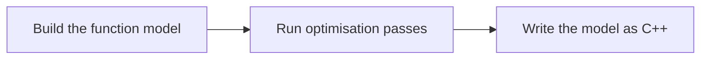

# Recompiling Functions

!!! warning "These docs are a bit more scrappy."

    Today is 5th October 2026, time is running out, I got 6 weeks!

!!! info "Time for the fun part."

	And that's turning each discovered function into one C++ function.

!!! note "Where this happens"

    `Recompiler::recompile` (`src/xbox-recomp2/src/recompiler.rs`).

## What goes in

For each function, the recompiler has:

- **The function:** its start address and size.
- **Its body** (usually): the instructions discovery found, and how
  they connect.
    - See [Pick the instructions].
- **The config:** [midasm hooks], [switch tables], banned and invalid ranges.
- **The executable:** the bytes to decode, symbols and imports.

## A running example

We'll follow one small function from Shadow the Hedgehog (NTSC-U) the whole
way through.<br/>
It's at `0x11410`:

```asm
0x11410: mov eax, [0x005356F0]   ; read a global
0x11415: test eax, eax
0x11417: jnz 0x11423             ; already set? skip to the end
0x11419: call 0x113B0            ; otherwise, compute it...
0x1141E: mov [0x005356F0], eax   ; ...and store it
0x11423: ret
```

In C, that's roughly:

```c
int cached_value;

int get_cached_value(void) {
    if (cached_value == 0)
        cached_value = compute_value();  // sub_113B0

    return cached_value;
}
```

And here's the C++ XboxRecomp2 writes for it:

```cpp
X86_PROTECTED_FUNC(sub_11410) {
	uint32_t val_uint32_0 = 0;

	// mov eax, [0x005356F0]
	ctx.eax.u32 = X86_LOAD_U32(0x5356f0);
	// test eax, eax
	ctx.eflags.update_test_flags_U32(ctx.eax.u32 & ctx.eax.u32);
	// jnz 0x00011423
	if (X86_CC_NZ(ctx)) goto loc_11423;
	// call 0x000113B0
	ctx.SubEsp(1); //Adjust stack pointer for call instruction
	sub_113B0(ctx, base);
	// mov [0x005356F0], eax
	X86_STORE_U32(0x5356f0, ctx.eax.u32);
loc_11423:
	// ret
	ctx.esp.u32 += 0x4;  //Adjust esp for return instruction
	return;
}
```

!!! note "With Optimizations Disabled*"

Every generated function receives the same two parameters:

- **`ctx`:** the guest CPU state. e.g.
    - Registers (`ctx.eax`, `ctx.esp`, ...),
    - Flags (`ctx.eflags`)
    - x87 FPU.

- **`base`:** a pointer to the start of guest memory. e.g.
    - `X86_LOAD_U32(0x5356f0)` reads 4 bytes at `base + 0x5356f0`.

So the guest's registers live in `ctx`, and its RAM lives at `base`.<br/>
The C++ just does to them what the original instructions did.

The rest of this page builds that output one piece at a time.

## At a glance

Each function goes through three stages:



1. **Build** (`codegen/function/build/mod.rs`) groups the function's
   instructions into a **function model** (`codegen/function/model/mod.rs`).

    The model holds blocks of instructions, with their labels and exits.

2. **Passes** (`codegen/optimizations/`) optimise code before it's emitted.

3. **Write** (`codegen/function/write/mod.rs`) turns the model into C++.

!!! question "Why build a 'model' first?"

    C++ needs some things *before* the code that uses them:

    - Hooks must be declared above the function that calls them.
    - Scratch variables must be declared at the top of the function.

    And an optimisation often needs to see the whole function before it can
    change one instruction.

## Step by Step

### Build the function model

!!! note "Where this happens"

    `codegen/function/build/mod.rs`: `build`, called by `build_function` in
    `codegen/function/mod.rs`.

#### 1. Find labels and hooks

!!! note "Where this happens"

    `codegen/function/build/labels/mod.rs`:

    - `collect_labels_from_body` for bodies
    - `collect_labels` for user defined ranges.

Jumps inside a function become C++ `goto`s.<br/>
A `goto` needs a label to land on:

```cpp
	if (X86_CC_NZ(ctx)) goto loc_11423;
	...
loc_11423:
```

Labels are named `loc_<address>`, in uppercase hex.<br/>
This follows IDA Pro convention most people are used to.

##### Which addresses get a label?

!!! note "Where this happens"

    `codegen/function/build/labels/mod.rs`:

    - `collect_labels_from_body` for function bodies.
    - `collect_labels` and `collect_jump_target` for user defined ranges.

!!! tip "Basically every time a `jmp` instruction pops up in original ASM"

An instruction gets a label when it's a target of:

- a `jmp`, or a conditional jump like `jnz`, `je` or `loope`.
- a case in a [`[[switch]]`][switch tables], i.e. a `jmp` through a jump table.
- a [midasm hook][midasm hooks] jump (`jump_address`,
  `jump_address_on_true`, `jump_address_on_false`).
- an instruction that runs right after another, but isn't right after it.
    - For example, if an (in)sane compiler decided to put data between two instructions.
    - The generated code would need a `goto` to reach it; see [Write each instruction].

The function entry, of course also gets one.

In our example, there's only a `goto` for `0x11423` .<br/>
It's where `jnz` jumps to.

##### Hooks

!!! note "Where this happens"

    `codegen/function/build/labels/mod.rs`: `collect_labels_from_body` and
    `collect_labels` fill `LabelPass::hook_addresses`.

This pass also makes keeps track of addresses that have a
[midasm hook][midasm hooks].

We'll need them later.

#### 2. Pick the instructions

!!! info "Decide which bytes are code, and in what order to write them."

!!! note "Where this happens"

    `codegen/function/build/mod.rs`:

    - `SelectedWalk` for bodies.
    - `InstructionWalk` for user defined ranges.

    Both feed `build`.

There are two ways to do this.

##### From the function body (the usual way)

!!! note "Where this happens"

    `codegen/function/build/mod.rs`: `SelectedWalk::next_step`.

!!! info "Discovery saves every instruction it reaches in a function."

    And all of the branches/control flow between them.

Recall [FunctionBody], which holds:

=== "Instructions & edges"

    ```text
    Instructions (address, length):
      0x11410 (5)   0x11415 (2)   0x11417 (2)
      0x11419 (5)   0x1141E (5)   0x11423 (1)

    Edges:
      0x11410 -> 0x11415   NextInstruction
      0x11415 -> 0x11417   NextInstruction
      0x11417 -> 0x11423   BranchTaken       ; jnz jumps
      0x11417 -> 0x11419   BranchNotTaken    ; jnz falls through
      0x11419 -> 0x1141E   NextInstruction   ; call returns here
      0x1141E -> 0x11423   NextInstruction
    ```

=== "ASM (for reference)"

    ```asm
    0x11410: mov eax, [0x005356F0]   ; read a global
    0x11415: test eax, eax
    0x11417: jnz 0x11423             ; already set? skip to the end
    0x11419: call 0x113B0            ; otherwise, compute it...
    0x1141E: mov [0x005356F0], eax   ; ...and store it
    0x11423: ret
    ```

Instructions are always written out in address order; i.e. same order
you read it in disassembly.

!!! note "There's some awkward cases to be aware of"

    Thankfully we handle them relatively cleanly.<br/>
    But if you're a nerd and want to know; the fact we replay the decoded
    instructions gives us a few things for 'free'.<br/>

    - **Data inside a function.** Bytes between instructions are never decoded.
        - So a jump table sitting in middle of code is unaffected.
        - Though I don't think any sane compiler would emit this; it is valid.
    - **Entry isn't the lowest address.** Some code sits *before* the
        function's entry.
        - See [Jump to the entry].

##### From a user defined range (`fixes.functions`)

!!! note "Where this happens"

    `codegen/function/build/mod.rs`: `InstructionWalk::next_step`.

!!! info "You know, for those moments where discovery gets a function wrong."

Functions listed in [`fixes.functions`] use a simpler mechanism.

Every byte from the start address to `start + size` is decoded.

```text
0x11410  decode -> 5 bytes, next at 0x11415
0x11415  decode -> 2 bytes, next at 0x11417
...
0x11423  decode -> 1 byte,  reached start + size, stop
```

Easy peasy!
Of course, `banned_addresses` and `invalid_instructions` are skipped.

!!! tip "Use this when discovery got a function wrong."

    You decide the range, so whatever's in it gets recompiled.<br/>
    The catch: any data inside the range gets decoded as code too.

##### Decode

[zydis] decodes the bytes:

```text
bytes:   75 0A
decoded: jnz 0x11423   (2 bytes)
```

### Run optimisation passes

!!! note "Where this happens"

    `codegen/optimizations/mod.rs`, called by `Recompiler::generate` in
    `recompiler.rs`.

See [Optimizations].

### Write the model as C++

!!! note "Where this happens"

    `codegen/function/mod.rs`: `write_function`.

    - Calls `write` in `codegen/function/write/mod.rs`.
    - `write` calls `write_body`.

#### 3. Name the function

!!! note "Where this happens"

    `codegen/function/mod.rs`: `write_function`.

!!! info "Pick a name."

The name comes from the symbol at the function's address:

- The entry point is `_xstart`.
- Functions without a symbol get `sub_<address>`, e.g. `sub_11410`.
    - Follows IDA Pro convention, which folks are already familiar with.
    - Easier to match up against a disassembly.

#### 4. Declare hooks

!!! note "Where this happens"

    `codegen/function/write/midasm_hook.rs`: `write_hook_declaration`.

!!! info "Hooks are your own C++ functions, called from the generated code."

From ShadowRecomp:

```cpp
extern bool EasierUnlockLastStoryMidAsmHook(X86Context& __restrict ctx, uint8_t* base);
```

In order to call your own C++ replacement for the original, we use `extern`.
The `clang` compiler will later link it up.

Calling convention is standard. See [midasm hooks] for how to write the C++
side.

#### 5. Write the opening lines

!!! note "Where this happens"

    `codegen/function/write/mod.rs`: `write`.

The opening line is written:

```cpp
X86_PROTECTED_FUNC(sub_11410) {
```

So each function exists under two names:

- **`__imp__sub_11410`:** the recompiled code itself.
- **`sub_11410`:** a public entry pointing at it.
    - Other generated code calls this one.

!!! tip "This is how you replace a whole function."

    Basically, if your host projects defines its own `sub_11410`, every call
    goes to your function.

    Should there be a need to call it, the original will be in
    `__imp__sub_11410`.

!!! warning "Your whole function hooks/overrides must be specified in config!"

    Add the overrides [`fixes.function_hooks`]!
    Some optimisations break ABI, so failure to do can lead to crashes.

    (Though more likely- build will just fail, as I added some safeguards...)

#### 6. Declare scratch variables

!!! note "Where this happens"

    `codegen/function/write/locals.rs`: `declare`.<br/>
    `codegen/function/write/mod.rs`: `write_local`.

    `write_body` calls both after optimisation passes.

Some instructions need a temporary value in their C++.<br/>
For example, an indirect `call` loads the target first:

```cpp
	// call [eax]
	val_uint32_0 = X86_LOAD_U32(ctx.eax.u32);
	ctx.SubEsp(1); //Adjust stack pointer for call instruction
	X86_CALL_INDIRECT_FUNC(val_uint32_0);
```

So the write step checks the instructions after optimisation passes, and lists
what's needed at the top of the function:

| Variable                                 | Declared for                                                    |
| ---------------------------------------- | --------------------------------------------------------------- |
| `uint32_t val_uint32_0`                  | `call`, `rep movsw`, `cmpsd`                                    |
| `uint32_t val_uint32_1`                  | `cmpsd` (needs two)                                             |
| `uint64_t val_uint64_0`, `val_uint64_1`  | `punpckldq`, `punpckhdq`                                        |
| `x87_float val_double_0`                 | x87 math and compares (`fadd`, `fsin`, `fcomip`, ...), `sqrtss` |
| `x87_float val_double_1`, `val_double_2` | `fsincos` (takes all three)                                     |

Each variable is declared once, at the top of the function.

In our example, the `call` asks for `val_uint32_0`:

```cpp
uint32_t val_uint32_0 = 0;
```

#### 7. Jump to the entry, if needed

!!! note "Where this happens"

    `codegen/function/write/mod.rs`: `write_entry`, called from `write_body`.
    `entry_of` in `codegen/function/build/mod.rs` chooses the entry action.

!!! note "TODO: Investigate and dedupe the duplicated code"

    Have not investigated scope of this, but a lot of 'forced inlining' like
    here could lead to unnecessary instruction cache thrashing.

!!! info "Sometimes the first instruction in address order isn't the function entry"

    There's a few cases like `tail calls` (jmp), where a function jumps to
    another location to complete its work.

    In that case, we include that other code inside the function body.
    And make the function body jump to the real entry using `goto`.

    `clang` is able to optimise this out, thankfully.

=== "Original ASM"

    ```asm
    ; ... called from function 0x1AE10 (0x1AE25) 
    0x1ACD0: mov   eax, [esp+0x04]
    0x1ACD4: shr   eax, 0x10
    0x1ACD7: cmp   ax, [ecx+0x02]
    0x1ACDB: jnz   0x1ACED
    0x1ACDD: mov   dx, [esp+0x04]
    0x1ACE2: cmp   dx, [ecx]
    0x1ACE5: jnz   0x1ACED
    0x1ACE7: mov   eax, [ecx+0x04]
    0x1ACEA: ret   0x04
    0x1ACED: xor   eax, eax
    0x1ACEF: ret   0x04

    ; ... other functions live here, not ours ...

    0x1AE10: mov   eax, [esp+0x04]    ; the entry
    0x1AE14: shr   eax, 0x10
    0x1AE17: cmp   ax, 0xFFFF
    0x1AE1B: jz    0x1AE2A
    0x1AE1D: movsx eax, ax
    0x1AE20: mov   ecx, [ecx]
    0x1AE22: lea   ecx, [ecx+eax*8]
    0x1AE25: jmp   0x1ACD0            ; pulls the block above into this function
    0x1AE2A: xor   eax, eax
    0x1AE2C: ret   0x04
    ```

=== "Written C++"

    Labels stay in address order, so the entry ends up in the middle.
    The `goto` at the top makes execution start there anyway:

    ```cpp
    X86_PROTECTED_FUNC(sub_1AE10) {
    	goto loc_1AE10;                // execution really starts here
    loc_1ACD0:
    	// mov eax, [esp+0x04]
    	...
    	// ret 0x04
    	return;
    loc_1AE10:
    	// mov eax, [esp+0x04]
    	...
    	// jmp 0x0001ACD0
    	goto loc_1ACD0;                // the tail jmp, now a plain goto
    loc_1AE2A:
    	// xor eax, eax
    	...
    }
    ```

#### 8. Write each instruction

!!! note "Where this happens"

    `codegen/function/write/mod.rs`: `write_block`, `write_guest` and
    `write_instruction`. One block of the function model at a time.

!!! info "The main event 🧑‍🍳🦔. Every instruction becomes 1-more lines of C++."

For each instruction, in address order, up to five things are written:

1. **A label**, if [Find labels and hooks] marked this address.
2. **A comment** with the original instruction, e.g. `// jnz 0x00011423`.
3. **A hook call**, if there's a hook at this address.
4. **The instruction's C++.**
5. **A block exit**, if needed: a `goto` or an abort.

Here's our `jnz` and the instruction it jumps to, split into those parts:

```cpp
    // jnz 0x00011423                    // <-- 2. comment
    if (X86_CC_NZ(ctx)) goto loc_11423;  // <-- 4. C++
    ...
loc_11423:                               // <-- 1. label
    // ret                               // <-- 2. comment
    ctx.esp.u32 += 0x4;  //Adjust esp for return instruction
    return;                              // <-- 4. C++
```

##### Write the comment

!!! note "Where this happens"

    `codegen/function/write/mod.rs`: `write_instruction_prefix` calls
    `DisasmFormatter::format` in `decode/format.rs`.

The decoded instruction is printed in Intel syntax as a `//` comment.

##### Call the hook

!!! note "Where this happens"

    `codegen/function/write/midasm_hook.rs`:

    - `write_hook_call_for_body`
    - `write_hook_call`

If there's a [midasm hook][midasm hooks] here, its call goes *before* the
instruction's own C++. From ShadowRecomp:

```cpp
	// cmp edi, 0x0A
	if (EasierUnlockLastStoryMidAsmHook(ctx.edi)) {
		goto loc_23D64F;                          // jump_address_on_true
	}
	else {
	}
	ctx.eflags.update_compare_flags_U32(ctx.edi.u32, 0xAu);
```

Each register is passed as `ctx.<register>`, so the hook can read and change
it.

| Hook keys set                        | Call becomes                                |
| ------------------------------------ | ------------------------------------------- |
| Only `name` (and `registers`)        | `Hook(...);`                                |
| `return`                             | `Hook(...); return;`                        |
| `jump_address`                       | `Hook(...); goto loc_...;`                  |
| `return_on_true` / `return_on_false` | `if (Hook(...)) { return; } else { ... }`   |
| `jump_address_on_true` / `_on_false` | `if (Hook(...)) { goto ...; } else { ... }` |

##### Emit the instruction

!!! note "Where this happens"

    `codegen/function/write/emit/instructions/`:

    - one file per mnemonic, such as `add.rs`
    - `lookup` in its `mod.rs` picks the file

Each emitter knows how to turn one instruction into C++. Some examples:

| Guest instruction | C++                                                       |
| ----------------- | --------------------------------------------------------- |
| `add eax, ecx`    | `X86_ADD32(ctx.eax.u32, ctx.ecx.u32, ctx);`               |
| `add eax, [ecx]`  | `X86_ADD32(ctx.eax.u32, X86_LOAD_U32(ctx.ecx.u32), ctx);` |
| `add [ecx], eax`  | `X86_ADD32_MEM(ctx.ecx.u32, ctx.eax.u32, ctx, base);`     |
| `add al, cl`      | `X86_ADD8(ctx.eax.u8_lo, ctx.ecx.u8_lo, ctx);`            |
| `jnz 0x1040`      | `if (X86_CC_NZ(ctx)) goto loc_1040;`                      |

A few patterns to notice:

- **Registers are fields of `ctx`:**
    - `eax` is `ctx.eax.u32`
    - `ax` is `ctx.eax.u16`
    - `al` is `ctx.eax.u8_lo`

- **Memory goes through macros:**
    - `X86_LOAD_U32(addr)` reads at `base + addr`
    - `X86_STORE_U32(addr, value)` writes at `base + addr`
- **Helpers update the flags:**
    - `test` becomes `ctx.eflags.update_test_flags_U32(...)`
    - a later `jnz` reads them through `X86_CC_NZ(ctx)`
- **The macros live in `x86_context.h`,** which is generated alongside the
  code.

Looks something like this:

```rust
ctx.out.line("if (X86_CC_Z(ctx)) {").indent();
ctx.out.line("return;").dedent();
ctx.out.line("}");
```

###### Calls and jumps

!!! note "Where this happens"

    - `codegen/function/write/emit/instructions/control_transfer/call.rs` and `jmp.rs`: `emit`
    - `codegen/function/write/emit/instructions/control_transfer/helpers.rs`:
      `print_conditional_branch` and `print_function_call_addr`

Control flow needs a bit more care. It depends on where the target is.

**Inside the function** (the target is in the body): a `goto`.

```cpp
	// jnz 0x00011423
	if (X86_CC_NZ(ctx)) goto loc_11423;
```

**Another function:** call it by name.

```cpp
	// call 0x000113B0
	ctx.SubEsp(1); //Adjust stack pointer for call instruction
	sub_113B0(ctx, base);
```

A `jmp` to another function is a [tail call]. It becomes a call, then a
`return`:

```cpp
	// jmp 0x00012070
	sub_12070(ctx, base);
	return;
```

**Through a register or memory** (`call eax`, `call [eax]`):

The address isn't known until runtime, so we look it up.

```cpp
	// call [eax]
	val_uint32_0 = X86_LOAD_U32(ctx.eax.u32);
	ctx.SubEsp(1); //Adjust stack pointer for call instruction
	X86_CALL_INDIRECT_FUNC(val_uint32_0);
```

`X86_CALL_INDIRECT_FUNC` looks up the host function for a guest address.

```cpp
// `x86_func_mapping.cpp`
X86FuncMapping X86FuncMappings[] = {
	{ 0x11000, sub_11000 },
	{ 0x11010, sub_11010 },
	...
```

**Kernel imports** (`call [0x00429AE4]`, see [Kernel thunks]): called
directly e.g. `__imp__RtlEnterCriticalSection(ctx, base);`.

**Switch tables:** a `jmp` through a [switch table][switch tables] becomes a
C++ `switch`. Cases inside the function use `goto`. Cases in another
function call it, then return.

```cpp
	// jmp [eax*4+0x180B4]
	switch (ctx.eax.u32) {
	case 0:
		goto loc_1801E;
	case 1:
		goto loc_18036;
	case 2:
		goto loc_180A5;
	case 3:
		goto loc_18059;
	case 4:
		goto loc_1806F;
	default:
		// With `debug = true` in `[main]`, the default case reports and aborts.
		// With `debug = false`, it is just `X86_UNREACHABLE();`.
		fprintf(stderr, "Unhandled switch index at 0x18017: %u (5 entries); check [[switch]] configuration.\n", static_cast<unsigned>(ctx.eax.u32));
		fflush(stderr);
		std::abort();
	}
loc_1801E:
	// push edi
	X86_PUSH(ctx, base, ctx.edi.u32);
	...
```

###### Platform-specific memory

!!! note "Where this happens"

    - `GuestPlatform::route` in `platform.rs` is the hook every platform
      implements.
    - `Xbox::route` in `src/xbox-recomp2-xbox/src/platform/mod.rs` is the
      Xbox version.
    - `Xbox::route` calls `route` in `fs.rs` and `ds.rs`, in the same
      directory.

Some addresses mean something special on an Xbox.<br/>
Two examples:

- The `fs` segment, which holds the kernel's per-CPU data.
- The GPU's registers.

##### Exit the block

!!! note "Where this happens"

    - `block_exit` in `codegen/function/build/mod.rs` chooses the exit during
      Build.
    - `write_block` in `codegen/function/write/mod.rs` writes the exit.
    - `write_block` calls `write_barrier` in the same file for aborts.

!!! info "C++ runs top to bottom. The guest might not."

Instructions are written in address order.<br/>
If execution would continue somewhere *other* than the next written line,
something must be added.

With a function body, after each instruction:

| Situation                                      | Written after it              |
| ---------------------------------------------- | ----------------------------- |
| Continues to the next written instruction      | nothing                       |
| Continues somewhere else                       | `goto loc_<target>;`          |
| Ends the block with `jmp` or `ret`             | nothing (it leaves by itself) |
| Ends the block with `int3`                     | abort                         |
| Ends the block with an unsupported instruction | abort                         |
| Ends the block with anything else              | abort                         |

In the case of `Continues somewhere else`; it looks something like this:

```cpp
	// mov eax, 1
	ctx.eax.u32 = 0x1u;
	goto loc_11020;    // the next written line isn't next in execution
loc_11010:
	...
```

Say that for some insane reasons the function had data in middle of it, or
we just couldn't decode. That's how we handle it.

!!! warning "Why abort instead of carrying on?"

    Makes debugging easier. If we abort, we know we f*cked up somewhere.

#### 9. Close the function

The closing brace is written:

```cpp
	return;
}
```

The finished text is appended to the current `x86_recomp.N.cpp` unit.
See [Write the outputs].

## When things go wrong

Each problem is printed to the console with its address. The generated code
also gets a `printf` or an abort, which fires when the game reaches that spot.

| You see                                        | Cause                                    | Fix                                                               |
| ---------------------------------------------- | ---------------------------------------- | ----------------------------------------------------------------- |
| `UNKNOWN FUNCTION REACHED`                     | A `call` to an unknown function          | Add it to [`fixes.functions`]. Garbage address: check boundaries. |
| `Missing instruction`                          | No emitter for it                        | Replace the function, or add an emitter                           |
| `Function doesn't end with JMP or RET`         | A [`fixes.functions`] range is too short | Check its size in a disassembler                                  |
| `Selected block ends without control transfer` | Wrong boundaries or missed code          | Set the range with [`fixes.functions`]                            |
| `Selected instruction ...`                     | Bad bytes: decode, mapping, length       | Report it, or use [`fixes.functions`]                             |
| `INT3 reached`                                 | Breakpoint or padding                    | Execution went somewhere it shouldn't                             |
| `Unhandled switch index`                       | No case for the index                    | See [Switch Tables][switch tables]                                |
| `midasm hook jumps outside function`           | Hook target is outside the function      | See [Find labels and hooks]                                       |

[Function Discovery]: function-discovery.md
[FunctionBody]: https://github.com/Sewer56/XboxRecomp2/blob/6d152d3e05b5ea70e18cb35b3e2dd536c6074951/src/xbox-recomp2/src/analysis/finalize/function_body.rs
[midasm hooks]: how-it-works.md#midasm-hooks
[switch tables]: how-it-works.md#switch-tables
[`fixes.functions`]: how-it-works.md#1-load-the-config
[Kernel thunks]: how-it-works.md#import-table-kernel-thunks
[Write the outputs]: how-it-works.md#6-write-the-outputs
[tail call]: function-discovery.md#4-tail-jump-scan
[Optimizations]: optimizations/index.md
[Pick the instructions]: #2-pick-the-instructions
[Find labels and hooks]: #1-find-labels-and-hooks
[Name the function]: #3-name-the-function
[Write the opening lines]: #5-write-the-opening-lines
[Jump to the entry]: #7-jump-to-the-entry-if-needed
[Write each instruction]: #8-write-each-instruction
[When things go wrong]: #when-things-go-wrong
[At a glance]: #at-a-glance
[`fixes.function_hooks`]: how-it-works.md#whole-function-replacements
[zydis]: https://github.com/zyantific/zydis
